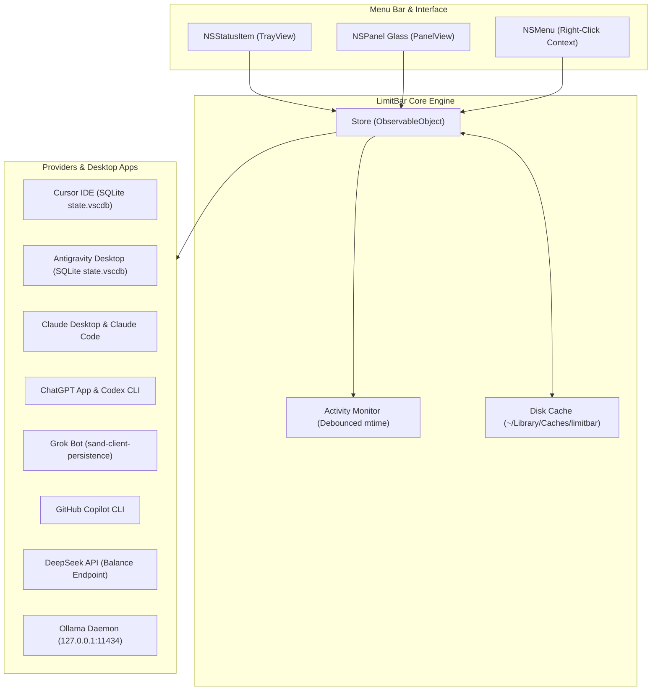

<div align="center">

# LimitBar

### Real-Time Usage & Limit Tracker for AI Coding Agents & Desktop Apps

[](https://apple.com)
[](https://swift.org)
[](LICENSE)
[](#security--privacy)
[](#kernel-sandbox-clisb)

*Track your rolling rate limits, fast requests, credit allowances, and API balances directly from your macOS menu bar.*

<br/>

> **Fork Notice**: Forked and extended from [dancik/limitbar](https://github.com/dancik/limitbar) with native desktop app integration, multi-agent framework tracking, DeepSeek API balance support, and Ollama local model monitoring.

</div>

---

## ⚡ Overview

When using multiple AI coding tools—such as Cursor, Google Antigravity, Claude, ChatGPT, Grok, Copilot, or DeepSeek—hitting a silent rate limit mid-flow is disruptive. 

**LimitBar** lives in your macOS menu bar, giving you:
- **Instant Glanceability**: Live percentage used for your primary window (e.g. `2%`, `18%ʷ`, `100%`) right on the menu bar.
- **Critical Threshold Alerts**: Numbers turn <span style="color:#ff3b30">red</span> at ≥ 90% usage, with an exclamation mark (`!`) if a secondary limit is hot.
- **Rich Popover Panel**: Hover or click the tray icon to see full breakdowns (5-hour windows, weekly quotas, fast requests, free full resets, and on-demand balances).
- **One-Click App Launch**: Click any provider header to instantly launch or focus its desktop application.
- **Zero Subprocess Overhead**: Reads local application caches and immutable SQLite databases whenever possible, falling back to kernel-sandboxed CLIs.

---

## 🧭 Supported Providers & Applications

| Provider | Tools Supported | Detection Method | Metrics Tracked |
| :--- | :--- | :--- | :--- |
| **Cursor** | Cursor IDE (`/Applications/Cursor.app`) | Immutable SQLite (`state.vscdb`) + Usage API | Fast request quota (e.g., 0 / 500), monthly reset date, plan tier |
| **Antigravity** | Google Antigravity IDE (`Antigravity.app`), `agy` CLI | Immutable SQLite (`state.vscdb`) / `agy -p /quota` | Google AI Pro / Ultra plan status, active models (Gemini 3 Pro, Claude 4.5), rolling quotas |
| **Claude** | Claude Desktop (`Claude.app`), Claude Code CLI | Desktop history cache (`plan-usage-history.json`) / `claude -p /usage` | 5-hour rolling session %, 7-day weekly %, per-model breakdown (Opus/Sonnet) |
| **OpenAI / ChatGPT** | ChatGPT Desktop (`ChatGPT.app`), Codex CLI | App-bundled CLI daemon (`codex-cli`) + local session logs | Weekly limit %, available free full resets, next credit expiry date |
| **Grok / xAI** | Grok Bot (`Grok Bot.app`), Grok Build CLI | Local client persistence (`sand-client-persistence/*.blob`) | Weekly credit utilization %, on-demand usage vs. allowance |
| **Copilot** | GitHub Copilot CLI | Native `copilot -p "/usage" --output-format json` | Premium requests used (e.g., 1500 / 1500), monthly reset |
| **DeepSeek** | DeepSeek API | `https://api.deepseek.com/user/balance` | Real-time balance (USD / CNY), currency symbol, low-balance alert |
| **Ollama** | Ollama Local Daemon | Local HTTP API (`127.0.0.1:11434`) | Active model name, VRAM allocation (GB), installed model inventory |

---

## 🔒 Security & Privacy

LimitBar is engineered from the ground up for strict security:

1. **Zero External Telemetry**: LimitBar has zero analytics, zero external trackers, and zero crash reporters.
2. **Read-Only SQLite Access**: Desktop databases (Cursor, Antigravity) are queried with `SQLITE_OPEN_READONLY | SQLITE_OPEN_URI` and `file://.../?immutable=1`. The app cannot lock, modify, or corrupt your IDE storage.
3. **Seatbelt Kernel Sandboxing (`cli.sb`)**: Whenever a subprocess CLI is invoked, it runs wrapped under macOS `/usr/bin/sandbox-exec` with a restrictive profile:
   - Denied access to your personal documents, Desktop, Downloads, or SSH keys.
   - Denied access to other apps' credentials, Keychain items (except `agy`), and environment variables.
   - Isolated working directory (`NSTemporaryDirectory()/limitbar-cwd`) so project configurations are never read.
4. **No Plaintext Credential Storage**: LimitBar never stores passwords or session cookies. API keys are kept in your user defaults or environment variables.

---

## 📦 Installation

### Option 1: Quick Install (Recommended)

Clone and build directly with Apple's native toolchain (no Xcode.app required; Command Line Tools is sufficient):

```bash
git clone https://github.com/w13/limitbar.git
cd limitbar
./scripts/build-app.sh build
cp -R build/LimitBar.app ~/Applications/
open ~/Applications/LimitBar.app
```

### Option 2: Automated Installer

```bash
bash <(curl -fsSL https://raw.githubusercontent.com/w13/limitbar/main/install.sh)
```

To build from source using the installer:
```bash
bash <(curl -fsSL https://raw.githubusercontent.com/w13/limitbar/main/install.sh) --from-source
```

To completely uninstall:
```bash
bash <(curl -fsSL https://raw.githubusercontent.com/w13/limitbar/main/install.sh) --uninstall
```

---

## ⚙️ Configuration

### Configuring DeepSeek API Key
You can configure your DeepSeek API key in two ways:
1. **Via UI**: Hover or pin the LimitBar panel, click **"Set Key"** or **"Setup Key"**, and paste your `sk-...` token in the secure input dialog.
2. **Via Terminal**:
   ```bash
   defaults write io.github.dancik.limitbar deepseekKey "sk-your-key-here"
   ```
   *(Or set `DEEPSEEK_API_KEY` in your environment or `~/.deepseek/api_key`)*

### Custom CLI Executable Paths
If your CLIs are in non-standard locations:
```bash
defaults write io.github.dancik.limitbar claudePath "/path/to/claude"
defaults write io.github.dancik.limitbar codexPath "/path/to/codex"
defaults write io.github.dancik.limitbar agyPath "/path/to/agy"
defaults write io.github.dancik.limitbar grokPath "/path/to/grok"
```

---

## 🖥️ UI & Interaction

- **Left-Click Tray**: Pins the details panel open. Click anywhere outside or click the tray icon again to dismiss.
- **Hover Tray**: Opens the panel after 150ms; dismisses after 250ms when leaving.
- **Right-Click Tray**: Opens a native macOS context menu:
  - **Refresh All** (`⌘R`)
  - **Launch at Login** (toggle)
  - **GitHub Repository…**
  - **Quit LimitBar** (`⌘Q`)
- **Arrow Icon (`↗`) on Provider**: Click the arrow next to any vendor name to bring that desktop application to the front.

---

## 🧪 CLI Mode (`--probe` & `--statusline`)

LimitBar can also be used as a standalone headless utility for terminal statuslines (tmux, Starship, sketchybar):

### 1. Snapshot Probe (`--probe`)
Inspect all detected tools as pretty-printed JSON:
```bash
/Applications/LimitBar.app/Contents/MacOS/LimitBar --probe
```

### 2. Claude Code Statusline Helper (`--statusline`)
Pipe Claude Code usage into LimitBar for near-zero CPU usage:
```json
// ~/.claude/settings.json
{
  "statusLine": "/Applications/LimitBar.app/Contents/MacOS/LimitBar --statusline"
}
```

---

## 🛠️ Architecture



---

## 📄 License & Attribution

- Released under the [MIT License](LICENSE).
- Upstream project: [dancik/limitbar](https://github.com/dancik/limitbar) by Daniel Cik.
- All product names, logos, and brands are property of their respective owners.
